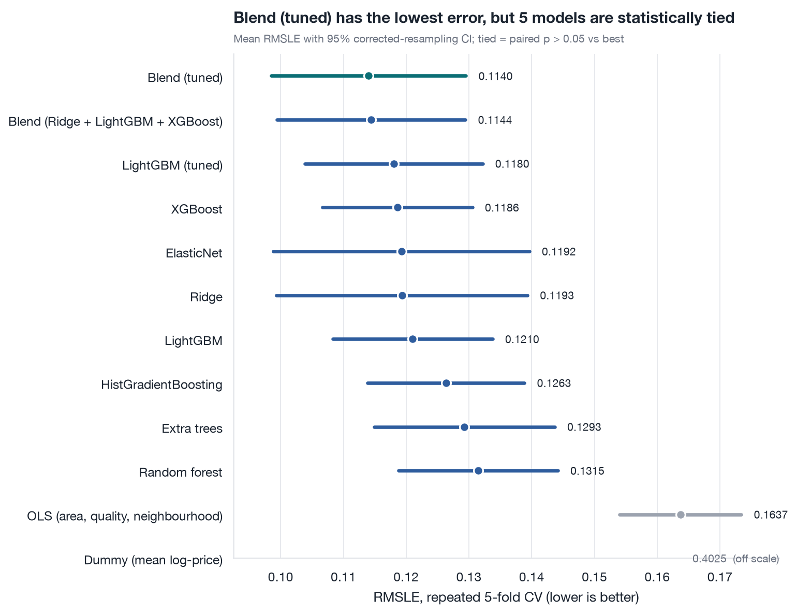
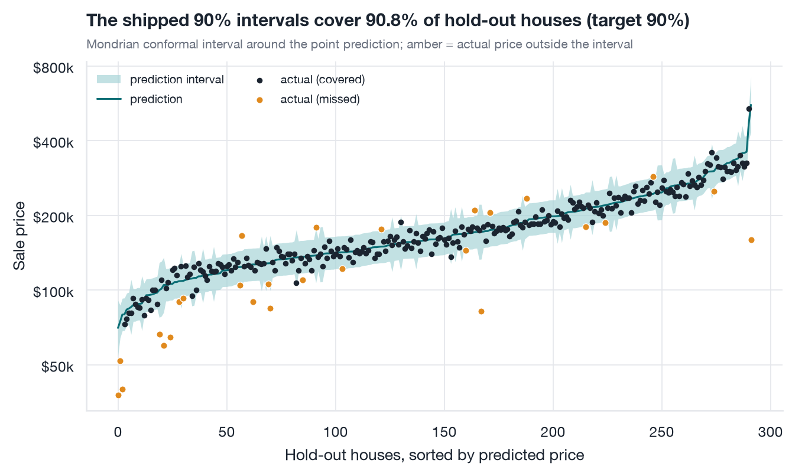
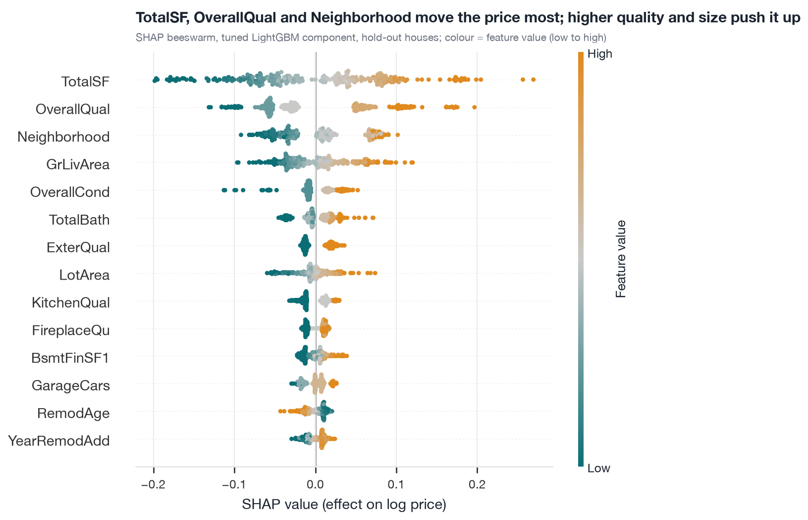

# Housing price prediction, done honestly

**Predict Ames, Iowa house prices from 79 features, with a calibrated 90 % prediction interval, a leakage-safe pipeline, and every number measured in this repo.**

| Headline (all measured, seed 42) | |
|---|---|
| Cross-validated RMSLE (5-fold x 3 repeats, n=1,168) | **0.1140** (95 % CI 0.0985 to 0.1295) |
| **Sealed hold-out** RMSLE (n=292, trained on the other 1,168) | **0.1433** (95 % bootstrap CI 0.1036 to 0.1873) |
| Hold-out RMSLE excluding one pre-flagged partial-sale outlier | 0.1235 |
| Typical error on the hold-out | median 4.8 % of price, MAE \$13,652 |
| 90 % interval, empirical hold-out coverage | **90.8 %** (95 % CI 86.9 to 93.6 %), median width 31 % of price |

The hold-out figure is the one to trust: it is higher than the CV estimate because one huge unfinished "partial" sale (Id 1299, predicted \$558k, sold for \$160k) landed in it. I report both, and the unfiltered number is the headline. RMSLE is the RMSE of `log(1+price)`, roughly a relative error: 0.14 is about a 14 % typical miss, dominated by a few unusual sales.



| Prediction intervals on the hold-out | Why the model predicts what it does |
|---|---|
|  |  |

## Quickstart

```bash
make setup data test      # uv venv (Python 3.12) + pinned deps, download data from OpenML, run tests
make notebooks            # execute the three notebooks top to bottom and train the final model (~4 min)
.venv/bin/python -m housing.predict examples/sample_house.json
```

No Kaggle account or token is needed: the data comes from OpenML (`house_prices`, id 42165). Requires [uv](https://docs.astral.sh/uv/).

## What is in here

```
src/housing/      installable package
  data.py           download/cache, data contract, deterministic split
  features.py       leakage-safe feature engineering (sklearn transformers)
  models.py         model zoo, all wrapped to fit log(price) and predict dollars
  evaluation.py     RMSLE, repeated CV, Nadeau-Bengio corrected CIs, paired tests
  tune.py           Optuna search (bounded runtime)
  interval.py       conformal prediction intervals (Mondrian; CQR as benchmark)
  schema.py         pydantic input schema   inference.py  validated prediction API
  train.py / predict.py   train CLI / prediction CLI   plotting.py  one house style
notebooks/        01_eda   02_modeling   03_error_analysis_and_explainability  (committed with outputs)
tests/            data contract, no-leakage, pipeline, inference round-trip
reports/          figures/ (committed PNGs) and results/ (CSV/JSON of every reported number)
models/           housing_model.joblib (0.5 MB) + model_metadata.json
docs/             DATA_CARD.md  MODEL_CARD.md
```

## Method

* **Target**: `log1p(price)`; the metric (RMSLE) is then plain RMSE, and errors are proportional rather than additive (notebook 01 shows the heteroscedasticity argument).
* **Missingness**: in Ames, NaN usually means "no such feature" (no pool, garage, basement...). 96 % of missing cells are of this kind and become an explicit `None` level, **only where a companion column confirms it** (`GarageArea == 0`, `TotalBsmtSF == 0`...). The few real gaps (e.g. `LotFrontage`) are imputed inside CV folds. No target value is ever imputed or invented.
* **No leakage**: every learned step (imputation, skew detection, scaling, one-hot vocabularies, cross-fitted target encoding) lives in an sklearn `Pipeline` and is re-fit on each training fold. Tests check this directly (rows scored are never fit on; imputer statistics equal training-only medians; a shuffled target is not predictable).
* **Evaluation**: 20 % hold-out sealed until notebook 03; model selection by 5-fold CV repeated 3 times; confidence intervals use the Nadeau-Bengio correction because CV scores are correlated; model differences use a corrected paired t-test.
* **Tuning**: Optuna TPE on LightGBM, 150 trials in 101 s, on a different CV seed than the evaluation. The tuned CV score is slightly optimistic (search 0.1137 vs 0.1180 on the evaluation CV); the hold-out is the unbiased number.
* **Intervals**: four methods compared on the hold-out. Raw quantile GBM under-covers (77 %); CQR and constant-width conformal reach about 92 %; CQR was no sharper than the simple method, so the shipped one is **Mondrian conformal** (a separate margin for normal and non-normal sales, since non-normal sales are about twice as hard), which is both calibrated (90.8 %) and the narrowest.

## Results (5-fold x 3 repeats CV on the 1,168 training rows)

| Model | RMSLE | 95 % CI | p vs best |
|---|---|---|---|
| **Blend (Ridge + tuned LightGBM + XGBoost)** | **0.1140** | 0.0985 to 0.1295 | - |
| Blend, untuned LightGBM | 0.1144 | 0.0994 to 0.1294 | 0.33 |
| LightGBM (tuned) | 0.1180 | 0.1039 to 0.1322 | 0.03 |
| XGBoost | 0.1186 | 0.1066 to 0.1306 | 0.06 |
| ElasticNet | 0.1192 | 0.0989 to 0.1396 | 0.10 |
| Ridge | 0.1193 | 0.0993 to 0.1393 | 0.08 |
| LightGBM (defaults) | 0.1210 | 0.1083 to 0.1338 | 0.003 |
| HistGradientBoosting | 0.1263 | 0.1138 to 0.1388 | <0.001 |
| Extra trees | 0.1293 | 0.1149 to 0.1437 | 0.002 |
| Random forest | 0.1315 | 0.1188 to 0.1442 | <0.001 |
| OLS (area, quality, neighbourhood) | 0.1637 | 0.1540 to 0.1734 | <0.001 |
| Dummy (mean log price) | 0.4025 | 0.3781 to 0.4268 | <0.001 |

The top five are statistically tied (p > 0.05): a regularised linear model is as good as boosting here, and the blend wins by averaging their different mistakes. Do not read the ranking inside that group as meaningful. Learning curves have largely plateaued, so more rows of the same features would help little.

## Limitations

* **Small, old, local data**: 1,460 sales in one Iowa town, 2006-2010. It will not transfer to other markets or today's prices.
* **Random, not temporal, split**: real future performance would be worse.
* **Heavy-tailed error**: the worst 1 % of houses cause 37 % of the squared error; non-normal sales (foreclosure, unfinished, family) are the weak spot. The hold-out is only 292 houses, hence the wide CI.
* **`SaleType`/`SaleCondition` are known only after a sale**, so this is not a listing-price tool as is.
* Only LightGBM was tuned; conformal guarantees are marginal and approximate; SHAP/permutation importances are associations, not causal effects; neighbourhood can proxy for socio-economic factors, so do not use such a model for lending or taxation without a fairness review.

Details: `docs/MODEL_CARD.md`, `docs/DATA_CARD.md`.

## Reproduce

`make setup data test notebooks lint`. Runtimes on a 10-core Apple-silicon laptop: notebook 01 2 s, notebook 02 148 s (101 s of it the Optuna search), notebook 03 42 s. CI (`.github/workflows/ci.yml`) runs lint, tests and a 400-row smoke execution of all notebooks (`make notebooks-smoke`). Seeds are fixed (42); a clean-venv rerun reproduced the same hold-out numbers to all printed digits.

Predict from Python:

```python
from housing.inference import load_model, predict_one
import json

print(predict_one(json.load(open("examples/sample_house.json"))))
# price=169383.3  lower=147541.5  upper=194458.6  interval_level=0.9   (actual sale price of this real row: $165,500)
```

Inputs are validated with pydantic (`housing.schema.HouseFeatures`): unknown fields, out-of-range values and unseen categories are rejected with a readable error.

## Licence

Code: MIT (c) Elchanan Treistman. The Ames data is not included; see `docs/DATA_CARD.md`.
